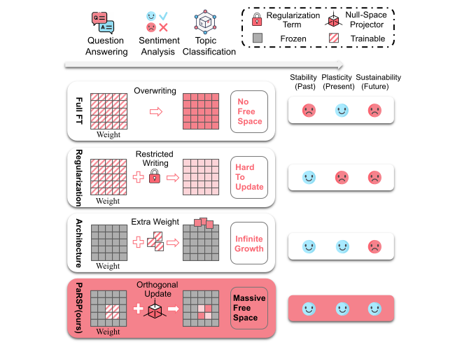
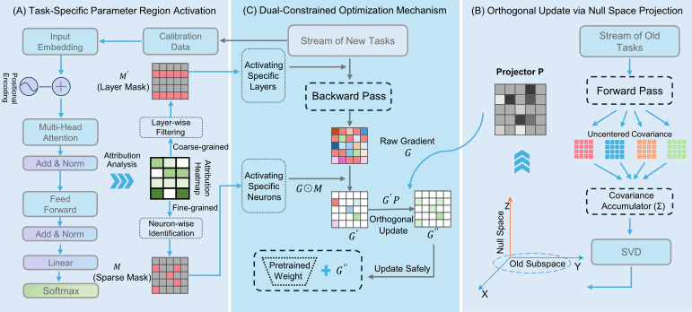
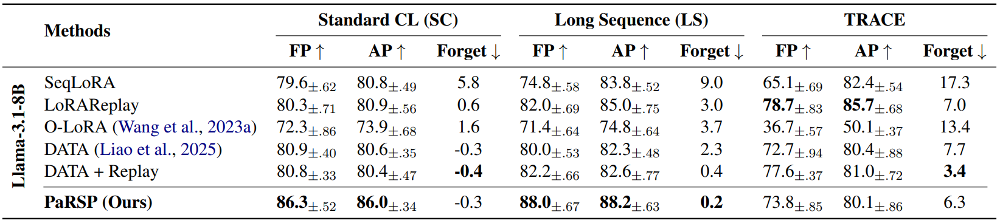

<div align="center">

# 🎼 PaRSP: Harmonizing the Past, Present, and Future

### A Null-Space Constrained Region-Specific Method for Continual Learning in LLMs

[](https://aclanthology.org/2026.acl-long.1244/)
[](https://pytorch.org/)
[](#experimental-results)
[](LICENSE)

**Official implementation of our ACL 2026 paper.**

[📄 Paper](https://aclanthology.org/2026.acl-long.1244/) &nbsp;|&nbsp;
[🔬 Method Overview](#method-overview) &nbsp;|&nbsp;
[📊 Experimental Results](#experimental-results) &nbsp;|&nbsp;
[📝 Citation](#citation)

</div>

---

## 💡 Introduction

Continual Learning (CL) studies how a model can continuously acquire knowledge from a sequence of tasks while retaining what it has learned previously. For Large Language Models (LLMs), this capability is essential for adapting to evolving domains, new task requirements, and continuously emerging knowledge.

However, learning new tasks can interfere with previously acquired knowledge. Updating model parameters to improve performance on the current task may overwrite existing representations, leading to catastrophic forgetting. Meanwhile, continuously modifying large portions of the model can consume valuable parameter capacity, limiting its ability to accommodate future tasks.

An effective continual learning paradigm for LLMs must therefore address three interconnected objectives: **preserving past knowledge, learning current tasks, and reserving sufficient capacity for future adaptation**.

To address these challenges, we propose **PaRSP (Null-Space Constrained Parameter Region-Specific Method)**, a brain-inspired, rehearsal-free continual learning framework. Motivated by the functional partitioning of biological neural systems, PaRSP identifies task-specific parameter regions and constrains gradient updates through null-space projection. By combining sparse parameter activation with orthogonal optimization, PaRSP aims to balance stability, plasticity, and sustainability throughout the continual learning process.

## 🧠 Motivation: Harmonizing the Past, Present, and Future

Sustainable continual learning requires a model to maintain three complementary capabilities:

- **🏛️ Stability — Preserving the Past:** Retain previously acquired knowledge and mitigate catastrophic forgetting when learning new tasks.
- **⚡ Plasticity — Learning the Present:** Adapt effectively to incoming tasks and acquire new task-specific knowledge.
- **🌱 Sustainability — Reserving for the Future:** Preserve sufficient parameter capacity to support continued learning and future adaptation.

Existing continual learning paradigms often struggle to balance these objectives:

- **Full Fine-Tuning:** Updates the entire parameter space to adapt to new tasks, but can overwrite previously learned knowledge and rapidly consume available capacity.
- **Regularization-Based Methods:** Constrain parameter updates to protect historical knowledge, but overly restrictive constraints may limit adaptation to new tasks.
- **Architecture-Based Methods:** Introduce additional task-specific components to reduce interference, but can lead to continuous parameter growth as new tasks arrive.

As illustrated in Figure 1, these approaches address different aspects of continual learning but leave challenges in achieving a unified balance among the Past, Present, and Future.

<p align="center">
  
</p>

<p align="center">
  <em>Figure 1: Comparison of continual learning paradigms across the Past (Stability), Present (Plasticity), and Future (Sustainability) dimensions.</em>
</p>

**PaRSP addresses these challenges through a unified parameter-space optimization strategy:** selectively activating task-relevant parameter regions for effective adaptation, while constraining update directions to protect previously learned representations and reserving the remaining parameter capacity for future tasks.

## ⚙️ Method Overview

PaRSP draws inspiration from the functional partitioning of biological neural systems, where specialized neural populations support specific functions while shared neural populations contribute to broader cognitive capabilities.

Based on this principle, PaRSP establishes a task-region mapping mechanism that distinguishes task-specific functional regions from shared representations. Its optimization framework consists of two synergistic stages, integrated through a dual-constrained update mechanism.

<p align="center">
  
</p>

<p align="center">
  <em>Figure 2: Overview of PaRSP, illustrating task-specific parameter region activation, null-space projector construction, and dual-constrained optimization.</em>
</p>

### Stage 1: Task-Specific Parameter Region Activation

**Core question: Where should the model update?**

PaRSP employs a static neuron-level attribution mechanism to identify the functional core most relevant to the current task.

- **Task-Specific Attribution:** Estimate the contribution of model components to the current task.
- **Functional Core Localization:** Identify the most relevant parameter regions through attribution-based selection.
- **Sparse Parameter Activation:** Construct a binary task-specific mask to activate selected parameters while freezing the remaining parameter space.

By restricting updates to task-relevant regions, PaRSP facilitates effective adaptation to the present task while preserving substantial parameter capacity for future learning.

### Stage 2: Orthogonal Update via Null Space Projection

**Core question: How can the model update without interfering with previous knowledge?**

Within the selected active regions, PaRSP introduces a geometric constraint based on Null Space Projection.

- **Historical Representation Modeling:** Accumulate uncentered covariance statistics from previous task activations.
- **Null-Space Projector Construction:** Apply Singular Value Decomposition (SVD) to identify the subspace associated with historical representations and construct the corresponding projection matrix.
- **Orthogonal Gradient Updates:** Project current task gradients onto the null space of previous task activations, constraining updates to directions that preserve historical representations.

This mechanism reduces interference between sequential tasks and provides a principled approach to protecting previously acquired knowledge.

### Dual-Constrained Optimization

The two stages are integrated into a unified optimization mechanism through two complementary constraints:

- **Spatial Constraint (Mask):** Determines which parameters are allowed to participate in the current task update.
- **Directional Constraint (Projector):** Restricts gradient updates to directions in the null space of historical representations.

The resulting parameter update is formulated as:

```math
W_l^{(t+1)}
=
W_l^{(t)}
-
\eta
\left[
\left(
\nabla_{W_l}\mathcal{L}_{\mathrm{task}}
\odot M_l
\right)
P_l
\right].
```

Here, $M_l$ denotes the task-specific parameter mask, $P_l$ denotes the null-space projector, and $\eta$ is the learning rate.

**In essence, the mask determines where to update, while the projector determines how to update safely.** Their synergy enables PaRSP to balance task adaptation, historical knowledge preservation, and future parameter capacity.

## 🏆 Experimental Results

We evaluate PaRSP on three continual learning benchmark categories with different task types and sequence lengths:

- **Standard CL (SC):** A standard continual learning benchmark consisting of four datasets arranged into multiple task sequences.
- **Long Sequence (LS):** A long-horizon benchmark covering 15 datasets, including classification tasks, GLUE, SuperGLUE, and IMDB.
- **TRACE:** An LLM-oriented benchmark comprising eight diverse datasets covering multi-choice question answering, multilingual capabilities, code generation, and mathematical reasoning.

Our experiments employ Llama-3.1-8B and Qwen-2.5-7B as model backbones. The main benchmark comparison below reports results for Llama-3.1-8B.

### Main Benchmark Results

<p align="center">
  
</p>

<p align="center">
  <em>Table 1: Main results on Standard CL (SC), Long Sequence (LS), and TRACE using the Llama-3.1-8B backbone. Results are reported as mean ± standard deviation over three independent runs. ↑ indicates higher is better; ↓ indicates lower is better.</em>
</p>

All performance values are percentages. We use three standard metrics:

- **Average Performance (AP):** Measures the average performance on tasks immediately after learning them, reflecting the model's ability to acquire new knowledge.
- **Final Performance (FP):** Measures the average performance across previously encountered tasks after completing the entire task sequence, reflecting long-term knowledge retention.
- **Forgetting (AP − FP):** Measures the performance degradation after sequential learning. Lower values indicate better knowledge retention.

**Key Findings:**

- **Strong Stability:** PaRSP achieves the best final performance among the compared methods on both Standard CL and Long Sequence benchmarks, reaching 86.3% and 88.0%, respectively.
- **Effective Plasticity:** On Long Sequence, PaRSP achieves an average performance of 88.2%, demonstrating strong adaptation across extended task sequences.
- **Rehearsal-Free Learning:** These results are achieved without relying on external experience replay, while activating only a sparse functional core.

### Generalization to Unseen Tasks

Beyond retaining performance on previously learned tasks, preserving the pretrained model's general knowledge and reasoning capabilities is essential for continual learning.

We evaluate PaRSP on four representative unseen-task benchmarks after continual learning on Order 1, using Llama-3.1-8B. The results are compared against the original zero-shot model and representative continual learning baselines.

<table align="center">
  <thead>
    <tr>
      <th align="center">Method</th>
      <th align="center">MMLU</th>
      <th align="center">BBH</th>
      <th align="center">GSM8K</th>
      <th align="center">AGIEval</th>
      <th align="center">FP</th>
    </tr>
  </thead>
  <tbody>
    <tr>
      <td align="center">Zero-Shot</td>
      <td align="center">65.65</td>
      <td align="center">62.12</td>
      <td align="center">56.33</td>
      <td align="center">17.72</td>
      <td align="center">-</td>
    </tr>
    <tr>
      <td align="center">SeqLoRA</td>
      <td align="center">63.58</td>
      <td align="center">11.90</td>
      <td align="center">0.00</td>
      <td align="center">20.60</td>
      <td align="center">79.92</td>
    </tr>
    <tr>
      <td align="center">LoRAReplay</td>
      <td align="center">60.24</td>
      <td align="center">5.99</td>
      <td align="center">1.82</td>
      <td align="center">10.69</td>
      <td align="center">80.13</td>
    </tr>
    <tr>
      <td align="center">O-LoRA</td>
      <td align="center">62.79</td>
      <td align="center">6.31</td>
      <td align="center">1.56</td>
      <td align="center">13.87</td>
      <td align="center">71.83</td>
    </tr>
    <tr>
      <td align="center">DATA</td>
      <td align="center">64.47</td>
      <td align="center">10.42</td>
      <td align="center">3.63</td>
      <td align="center">16.94</td>
      <td align="center">81.39</td>
    </tr>
    <tr>
      <td align="center"><strong>PaRSP (Ours)</strong></td>
      <td align="center"><strong>66.72</strong></td>
      <td align="center"><strong>56.74</strong></td>
      <td align="center"><strong>56.03</strong></td>
      <td align="center"><strong>20.03</strong></td>
      <td align="center"><strong>86.30</strong></td>
    </tr>
  </tbody>
</table>

<p align="center">
  <em>Table 2: Generalization performance on unseen tasks using Llama-3.1-8B after continual learning on Order 1. FP denotes final performance on the continual learning sequence.</em>
</p>

**Key Findings:**

- **Preserved Reasoning Capabilities:** PaRSP substantially mitigates the degradation on reasoning-intensive benchmarks such as BBH and GSM8K compared with conventional continual learning baselines.
- **Strong Knowledge Generalization:** PaRSP achieves 66.72% on MMLU and 20.03% on AGIEval, both exceeding the corresponding zero-shot results.
- **Retention of General Intelligence:** PaRSP maintains performance close to the zero-shot baseline on GSM8K, while substantially outperforming other continual learning baselines on BBH and GSM8K.

These results demonstrate that PaRSP can acquire new task-specific capabilities while retaining strong generalization and reasoning performance on previously unseen tasks.

## 📝 Citation

If you find our methodology or code useful for your research, please consider citing our ACL 2026 paper:

```bibtex
@inproceedings{chen-etal-2026-harmonizing,
    title = "Harmonizing the Past, Present, and Future: A Null-Space Constrained Region-Specific Method for Continual Learning in {LLM}s",
    author = "Chen, Jinhui  and
      He, Shizhu  and
      Yang, Xingchang  and
      Liao, Huanxuan  and
      Wang, Yequan  and
      Liao, Xiangwen  and
      Teng, Wenhao  and
      Liu, Kang  and
      Zhao, Jun",
    editor = "Liakata, Maria  and
      Moreira, Viviane P.  and
      Zhang, Jiajun  and
      Jurgens, David",
    booktitle = "Proceedings of the 64th Annual Meeting of the {A}ssociation for {C}omputational {L}inguistics (Volume 1: Long Papers)",
    month = jul,
    year = "2026",
    address = "San Diego, California, United States",
    publisher = "Association for Computational Linguistics",
    url = "https://aclanthology.org/2026.acl-long.1244/",
    doi = "10.18653/v1/2026.acl-long.1244",
    pages = "27013--27033",
    ISBN = "979-8-89176-390-6"
}
```

## 🛡️ License & Contact

This project is licensed under the [Apache License 2.0](LICENSE).

Copyright and attribution information is provided in [NOTICE](NOTICE).

For questions, bug reports, or technical discussions, please open an issue in this repository.

